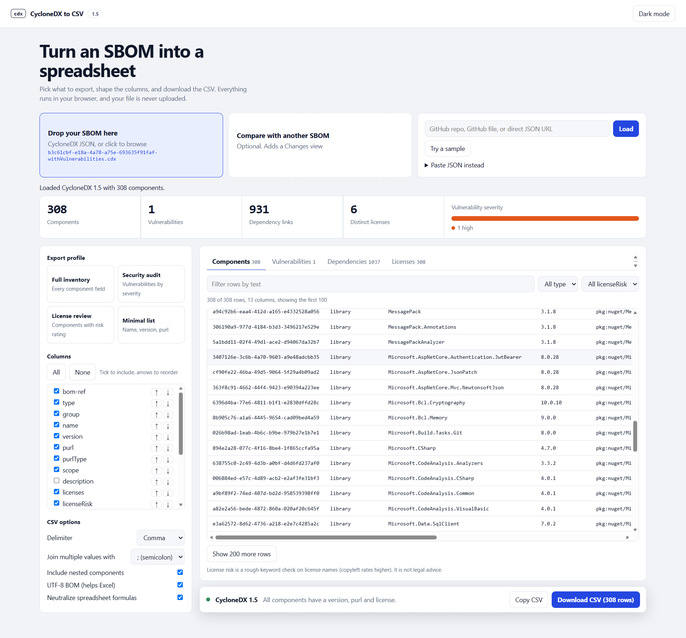

# CycloneDX to CSV

Convert a [CycloneDX](https://cyclonedx.org/) SBOM (JSON) into clean, spreadsheet-ready CSV files, entirely in your browser.

**Live app:** `https://bytebp.github.io/cyclonedx-to-csv/`



## Why this exists

SBOMs are great for machines and awkward for people. Security reviews, license audits and compliance reports usually end up in a spreadsheet, and CycloneDX JSON is deeply nested (components inside components, multiple licenses and hashes per item, vulnerabilities pointing at component references). This tool flattens it into tables you can filter, sort and share, without installing anything or uploading sensitive data anywhere.

## Features

- **100% client-side.** No backend, no uploads, no tracking. Your SBOM never leaves your machine.
- **Four exports from one file:** Components, Vulnerabilities, Dependencies, Licenses.
- **Compare two SBOMs.** Drop a second file to get a *Changes* view of added, removed and updated components.
- **Export profiles:** Full inventory, Security audit, License review, Minimal list.
- **Column control:** choose, reorder, select all or none for each export.
- **Live preview** with sorting, text search and per-tab filters (type, severity, license risk, status and more).
- **Summary dashboard:** component, vulnerability, dependency and license counts plus a severity breakdown.
- **Data quality check:** flags components with no version, purl or license.
- **License risk badge:** a rough keyword check that rates copyleft licenses higher.
- **CSV options:** delimiter, multi-value separator, UTF-8 BOM for Excel, optional nested components.
- **Spreadsheet-safe output:** cells that start with `=`, `+`, `-` or `@` are neutralized to prevent CSV formula injection.
- **Light and dark themes**, saved between visits, with keyboard-accessible controls.

## Getting started

### Use it online

1. Open the live app.
2. Load an SBOM using any of these:
   - drag and drop a `.json` file, or click the drop zone to browse
   - paste JSON into the text box
   - enter a URL (see [Loading from a URL](#loading-from-a-url))
   - click **Try a sample** to explore with demo data
3. Pick an **export profile**, or adjust the columns and options yourself.
4. Check the preview, then click **Download CSV** or **Copy CSV**.

### Run it locally

The app is a single static file with no dependencies and no build step.

```bash
git clone https://github.com/ByteBP/CycloneDX-to-CSV.git
cd <repo>

# Option 1: just open index.html in your browser
# Option 2: serve it locally
python3 -m http.server 8080
# then visit http://localhost:8080
```

## Loading from a URL

| You enter | What happens |
|---|---|
| A GitHub file link (`github.com/owner/repo/blob/branch/path/bom.json`) | Converted to its raw URL and fetched |
| A GitHub repo link (`github.com/owner/repo`) | Looks in the repo root, on the default branch, for `bom.json`, `sbom.json`, `bom.cdx.json`, `sbom.cdx.json`, `cyclonedx.json` or `cdx.json` |
| Any other direct JSON URL | Fetched as is. The host must allow cross-origin requests (CORS) |

Notes: private repositories are not supported, and unauthenticated GitHub API calls are limited (60 per hour per IP). If a repo link fails, paste a direct link to the file instead.

## What gets exported

| Export | One row per | Columns |
|---|---|---|
| **Components** | component (optionally including nested ones) | `bom-ref`, `type`, `group`, `name`, `version`, `purl`, `purlType`, `scope`, `description`, `licenses`, `licenseRisk`, `licenseUrl`, `copyright`, `hasCopyright`, `authors`, `supplier`, `publisher`, `manufacturer`, `website`, `vcs`, `hashes`, `cpe`, `externalRefs`, `multiVersion`, `parent`, `direct` |
| **Vulnerabilities** | vulnerability | `id`, `source`, `severity`, `score`, `method`, `vector`, `cwes`, `description`, `published`, `updated`, `affects`, `state`, `justification`, `recommendation` |
| **Dependencies** | dependency link (`ref` to `dependsOn`) | `ref`, `refName`, `dependsOn`, `dependsOnName` |
| **Licenses** | component and license pair | `component`, `version`, `purl`, `licenseId`, `licenseName`, `url`, `expression`, `copyright` |
| **Changes** *(when comparing)* | added, removed or updated component | `status`, `name`, `before`, `after`, `purl` |

Derived columns:

- `purlType`: the ecosystem from the package URL (for example `npm`, `maven`, `nuget`).
- `parent`: the name of the enclosing component for nested components.
- `direct`: `yes` if the root component depends on it directly, otherwise `no` (empty if the SBOM has no root dependency data).
- `licenseRisk`: `high`, `medium`, `low` or `unknown`. See the note below.
- `copyright`: the component `copyright` field, falling back to `evidence.copyright` when present. `hasCopyright` is `yes` or `no`, handy as a filter.
- `authors`: names (and emails when given) from `authors` (spec 1.6+), plus the older single `author` field.
- `website` and `vcs`: external references of those types. All other reference types stay in `externalRefs` as `type:url`.
- `licenseUrl`: the URL attached to a license entry, useful for following up on "Unknown" licenses.
- `multiVersion`: `yes` if the same package appears in more than one version in this SBOM.
- `severity` and `score`: taken from the highest-scoring rating of each vulnerability.
- Multi-value fields (licenses, hashes, affected components, and so on) are joined with the separator you choose.


### How comparison works

Components are matched by package URL with the version removed (or by `group/name` when there is no purl). A component present in both files with a different version is reported as `changed`; one only in the second file is `added`; one only in the first is `removed`. Unchanged components are omitted.

### About license risk

The risk badge is a simple keyword heuristic on license names: GPL, AGPL and SSPL rate **high**, LGPL, MPL, EPL, CDDL and EUPL rate **medium**, other named licenses rate **low**, and missing licenses are **unknown**. For SPDX expressions such as `MIT OR GPL-3.0-only` the most restrictive match wins. It is a triage aid, **not legal advice**.

## Privacy and security

- All parsing and conversion happen locally in your browser tab.
- The only network requests are the ones you trigger by loading a URL, which go to GitHub or the host you entered.
- Settings (selected columns, order, CSV options, theme) are saved in your browser's `localStorage`. SBOM contents are never stored.
- Formula neutralization prefixes risky cells with an apostrophe. Turn it off in the CSV options if you need exact raw values.

## Known limitations

- Accepts **CycloneDX JSON** only. XML is not supported yet.
- Built for **spec version 1.5**. Other versions may load but can be only partly mapped, and the app will tell you.
- The check on load verifies the document structure (`bomFormat`) but is **not a full JSON Schema validation**.
- Very large SBOMs (tens of MB) are parsed on the main thread and may briefly freeze the tab.
- CSV is downloaded one file per tab; there is no multi-file archive export yet.

## Browser support

Any current version of Chrome, Edge, Firefox or Safari. The app uses modern CSS (such as `color-mix`) and the Clipboard API.

## Contributing

Issues and pull requests are welcome. Because the app is one static file, a typical change is a quick edit to `index.html`. Please test with the built-in sample and at least one real SBOM before opening a pull request, and describe what you changed and why.

## License

Released under the MIT License. See [LICENSE](LICENSE) for details.

## Acknowledgements

Built around the [CycloneDX](https://cyclonedx.org/) specification, an OWASP flagship standard for software bills of materials.
